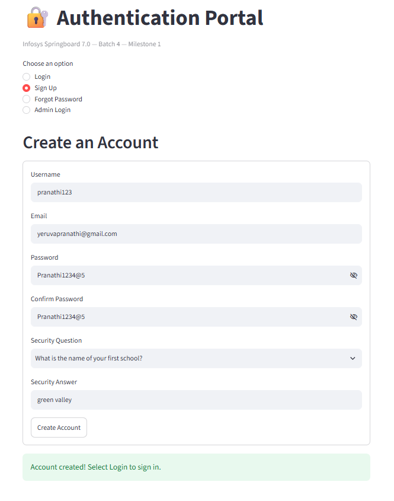
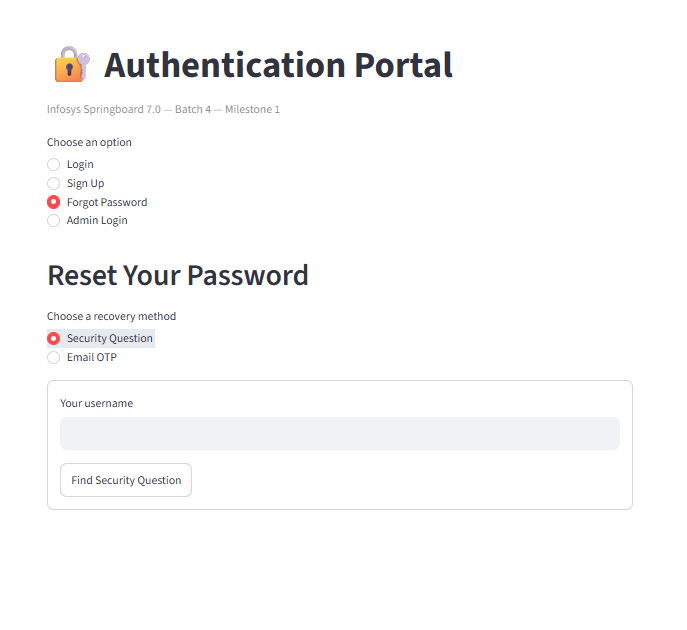
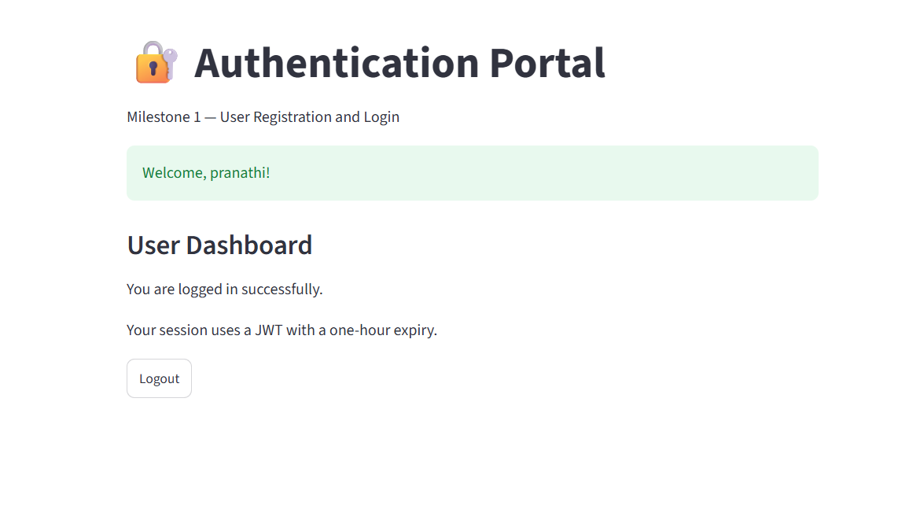

# Authentication Portal – Infosys Springboard Milestone 1

## Project Overview

The **Authentication Portal** is a secure, web-based user authentication application developed as part of the **Infosys Springboard Internship 7.0 – Batch 4, Milestone 1**.

The application provides user registration, login, password recovery, and an administrator dashboard. It incorporates password validation, secure password hashing, JSON Web Token (JWT) authentication, and email-based OTP verification to support secure access and account management.

## Objectives

- Develop a user-friendly authentication system.
- Implement secure user registration and login.
- Provide password recovery through security questions and email OTP verification.
- Protect authenticated sessions using JWT.
- Provide an administrator interface to view registered users.
- Validate user inputs and enforce password security requirements.

## Key Features

### 1. User Registration
- Register using a username, email address, and password.
- Confirm passwords before registration.
- Configure a security question and answer.
- Validate email format and password strength.

### 2. User Login
- Authenticate users using their registered credentials.
- Verify passwords securely.
- Generate and validate JWTs for authenticated access.
- Provide access to the user dashboard after successful authentication.

### 3. Password Recovery
- Reset passwords using a registered security question and answer.
- Reset passwords using an email-based OTP.
- Validate OTPs and enforce an expiration period.
- Return users to the login page after a successful password reset.

### 4. User Dashboard
- Display a welcome message after successful authentication.
- Provide a logout option.

### 5. Admin Dashboard
- Provide a separate administrator login.
- Display registered usernames and email addresses.
- Keep user passwords hidden from the administrator dashboard.
- Provide an administrator logout option.

## Technology Stack

| Component | Technology |
|---|---|
| Programming Language | Python |
| Web Application Framework | Streamlit |
| Database | SQLite |
| Authentication | JSON Web Tokens (JWT) |
| Password Security | PBKDF2 password hashing |
| Email Verification | SMTP with Gmail |
| Public Access | ngrok |
| Development Environment | Google Colab |
| Version Control | Git and GitHub |

## Application Screenshots

### Admin Dashboard
Displays registered usernames and email addresses.


### User Registration
Provides the registration form and security-question setup.



### Password Recovery
Supports account recovery and password reset.



### User Dashboard
Displays the authenticated user's dashboard.



## Security Measures

- Passwords are stored as hashes rather than plain text.
- Password validation enforces minimum length and character requirements.
- JWTs are validated before protected dashboard access.
- Email OTPs have a limited validity period and verification attempts.
- Sensitive configuration values are managed using environment variables and Google Colab Secrets.
- Administrator access is separated from regular user access.

## Project Structure

```text
Milestone1/
├── app.py
├── users.db
├── README.md
├── Milestone1_Authentication.ipynb
└── screenshots/
    ├── admin login.png.png
    ├── resetpassword.png.png
    ├── signup.png.png
    └── userdashboard.png.png
```

*Note: The project structure above represents the expected organization. Include only files and folders that actually exist in your repository. Do not commit credentials or sensitive database information.*

## Running the Application

The application was developed and tested in Google Colab.

1. Open the project notebook in Google Colab.
2. Configure the required secrets, including JWT, ngrok, email, and administrator credentials.
3. Install the required Python dependencies.
4. Start the Streamlit application.
5. Open the generated ngrok URL to access the Authentication Portal.
6. Test registration, login, password recovery, and administrator access.

**Important:** Never publish API tokens, Gmail App Passwords, administrator passwords, or other secret values in the notebook or repository.

## Conclusion

The Authentication Portal demonstrates the implementation of essential authentication and account-management features using Python and Streamlit. It combines user registration, secure login, password recovery, JWT-based access control, and administrator functionality in a single application.

This project strengthened practical knowledge of web application development, database integration, authentication, password security, email verification, and version control.

---

**Project:** Infosys Springboard Internship 7.0 – Batch 4, Milestone 1  
**Repository:** [infosys-maritime-ai](https://github.com/pranathi1234-ye/infosys-maritime-ai)

